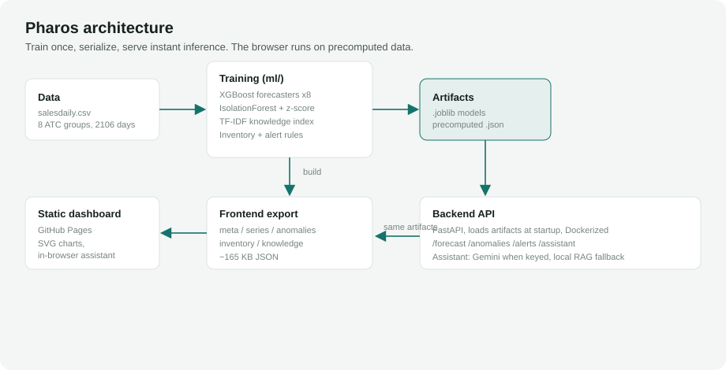

<p align="center">
  
</p>

<h1 align="center">Pharos</h1>
<p align="center">Pharmacy demand intelligence. See demand before it happens.</p>

Pharos turns six years of daily pharmacy point-of-sale data into an operations
tool: a demand forecast for every drug group, restock and expiry alerts, unusual
sales detection, and a grounded drug-information assistant. Models are trained
once and serialized, so both the API and the browser serve instant results.

**Live dashboard:** https://mustafa-elsherif.github.io/pharos-demand-intelligence/



## What it does

- **Demand forecast.** A gradient boosted model per ATC group predicts daily units
  and is rolled forward for a 30 day outlook with a measured uncertainty band.
- **Stock alerts.** Reorder points are forecast demand over the supplier lead time
  plus safety stock for a 95 percent service level. Expiry is tracked per batch.
- **Unusual sales.** A robust z-score explains per-group deviations and an isolation
  forest flags whole days that look odd across the product mix.
- **Assistant.** Retrieval-augmented answers grounded in a curated knowledge base,
  multilingual, with guardrails that decline personal dosing and diagnosis.

## Why these models

| Problem | Choice | Reasoning |
|---|---|---|
| Daily demand | XGBoost on lag, rolling and calendar features | Captures weekday and seasonal structure and nonlinear lag effects; beats the seasonal baseline by ~25% MAE while staying fast to train and serve |
| Forecast honesty | Seasonal-naive and persistence baselines | A forecast is only credible against a transparent baseline; skill is reported, not just raw error |
| Anomalies | Robust z-score + IsolationForest | Median/MAD avoids the normality assumption the skewed low-count groups break; the forest adds a multivariate view |
| Assistant | TF-IDF retrieval + Gemini or local fallback | Keeps answers grounded and auditable with citations; works offline, and upgrades to fluent multilingual generation when a key is present |

Honest headline metric: **+25.1% average MAE skill over seasonal naive** across the
eight groups. Full table in [docs/MODEL_CARD.md](docs/MODEL_CARD.md).

## Dataset
Daily point-of-sale counts for eight ATC groups (M01AB, M01AE, N02BA, N02BE, N05B,
N05C, R03, R06), 2 Jan 2014 to 8 Oct 2019, 2106 days with no gaps. Public, no login
required. Stored at `data/salesdaily.csv`.

## Run it

### Rebuild the model artifacts
```bash
pip install pandas numpy scikit-learn xgboost joblib pyarrow
python ml/train_forecast.py
python ml/train_anomaly.py
python ml/generate_forecasts.py
python ml/build_inventory.py
python ml/build_knowledge.py
python ml/export_frontend_data.py
```

### Backend API
```bash
cd backend
pip install -r requirements.txt
uvicorn app.main:app --reload
# docs at http://localhost:8000/docs
```
Set `GEMINI_API_KEY` to enable Gemini generation; without it the assistant uses the
local grounded fallback.

### Docker
```bash
cd backend
docker build -t pharos-api .
docker run -p 8000:8000 pharos-api
```

### Frontend
```bash
cd frontend
python -m http.server 8777   # open http://localhost:8777
```

## API

| Method | Path | Description |
|---|---|---|
| GET | `/health` | Service status and assistant engine |
| GET | `/api/categories` | Groups and forecast metrics |
| GET | `/api/forecast?category=N02BE&horizon=14` | Forecast with uncertainty band |
| GET | `/api/anomalies` | Precomputed anomalies |
| POST | `/api/anomalies/score` | Score one day of sales |
| GET | `/api/alerts` | Low-stock and expiry alerts |
| POST | `/api/assistant` | Grounded assistant reply with sources |

## Notebooks
`notebooks/` documents the work end to end: `01` data exploration, `02` demand
forecasting and evaluation, `03` anomaly detection, `04` the grounded assistant.

## Layout
```
data/        salesdaily.csv, drug_knowledge.json
ml/          training and export scripts
backend/     FastAPI app, artifacts, tests, Dockerfile
frontend/    static dashboard and precomputed data
notebooks/   analysis and modelling
docs/        architecture diagram, model card
```

## Tests
```bash
cd backend && pytest -q
```

See [DEPLOYMENT.md](DEPLOYMENT.md) for hosting.
